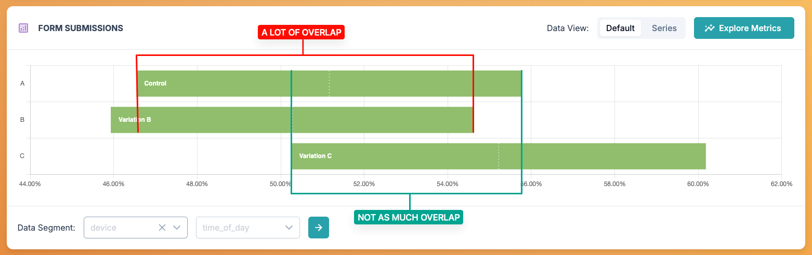

# Analyzing Data

How to read split test results in the Splitty Test dashboard.

## Before You Decide

* **Let the test run.** Early results swing a lot. Don't stop a test just because it looks great or terrible after a few days.
* **Test bold changes.** Small tweaks often produce differences too small to detect. Big wins and big losses are both easier to learn from.
* **Trust the data, but check for bugs.** If results look impossible, verify your integration before acting on them.

## Reading the Results Chart

A test's detail page shows a chart with one horizontal bar per active variation, and a table of raw data below it.

Think of each bar as a bell curve seen from above: the center is the variation's mean, and the ends mark the spread around it. When bars overlap heavily, there isn't enough data yet to tell the variations apart. The further apart they move, the more significant the result. Once a variation reaches the test's target confidence, its bar changes color.

### Data Smoothing

With little data, the charts can jump around and tempt you to call a test too early. If you know roughly what your metric usually looks like, you can enter those typical values to smooth the early data. The results then diverge gradually instead of swinging back and forth.

## What Is Confidence?

Confidence tells you how unlikely it is that a difference between two variations is just random chance. At 95% confidence, a gap that large would show up only about 5% of the time if the variations actually performed the same. Higher targets give you more certainty but take more data to reach.

A test's **Target Confidence Interval** setting decides:

* **Standard tests:** when a variation is marked as confident in the results table.
* **Auto-optimized tests:** when a variation that's clearly trailing the leader gets paused.
